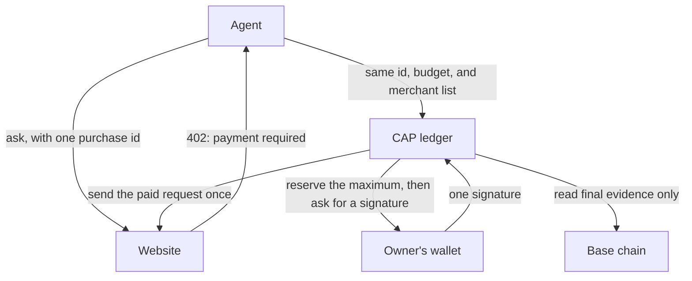
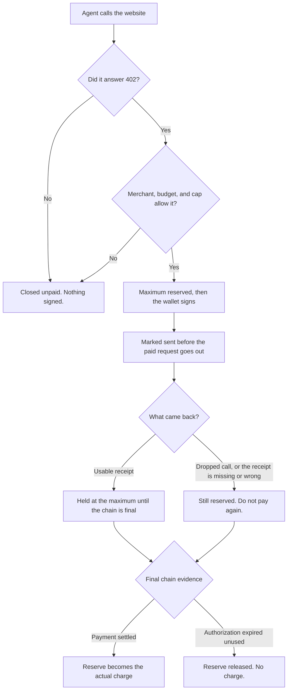

# CAP

An agent can pay for something with the owner's money. If the connection drops, nobody knows whether that payment went through. Asking again with a new purchase can spend the money twice.

CAP (Controlled Agent Payments) is the record that stops that. It lets an agent spend the owner's USDC on a website that already answers HTTP 402, the "payment required" response from [x402](https://github.com/coinbase/x402). One purchase keeps one id. A shared budget and a per-payment cap limit the spend. Only listed merchants can be paid. If the outcome is unclear, that same purchase stays open until there is final evidence.

Experimental and unpublished. Tested on Apple Silicon with Node 24.22.2 and Rust 1.93.0. The dependency scan still fails on [RUSTSEC-2026-0387](SECURITY.md#current-release-gate). An AI-assisted source review is not an independent audit, and local checks are not a test with real funds on a chain.

## The problem

A paid website can answer "payment required" instead of doing the work. The agent pays with the owner's USDC and tries again. That works when the answer comes back.

It breaks when the answer does not come back. The payment may have landed, or it may not. An automatic retry that starts a fresh purchase will pay a second time. The owner cannot see, from the agent's next attempt, which of those happened.

That matters because the spender is a program. It will retry. The money is not the program's.

## What CAP does

CAP sits between the agent and the website. It does not hold the wallet keys, and it does not take custody of the USDC. The owner still signs. CAP writes down the purchase before that signature and does not open a second one for the same id.



Before any signature, CAP checks three things:

- the website is on the merchant list
- this purchase is inside the shared budget
- this purchase is under its own cap

USDC here means the pinned dollar-pegged token on Base, or on Base Sepolia for tests. Amounts are decimal strings. 1 USDC is `1000000`, because the token uses six decimal places.

## What happens to one purchase



"Reserved" is a row in CAP's books. It is not money locked in escrow. A later HTTP 402 does not refund a payment that already moved. Paying the website does not mean the work was useful.

If the outcome is unclear, keep the same purchase id and reconcile it. A new id is a new purchase.

## What you bring

CAP does not log in, hold keys, or choose which chain node to trust. Your application brings:

| You supply | Why |
| --- | --- |
| An authenticated caller | Ids are labels. They do not grant access. |
| A signer with `address` and `signTypedData` | CAP asks the wallet to sign. It never sees the key. |
| A read-only chain connection you trust | Recovery is only as honest as that connection. |
| Your existing PostgreSQL pool | The ledger lives there. CAP does not open or close the pool. |
| The merchant list and the budget | These are the limits on this spend. |

## Usage

Packages are not published yet. [Build from source](CONTRIBUTING.md#development) or [install matching local tarballs](CONTRIBUTING.md#local-packages).

Create the schema, the budget, and the client once. This example buys one answer from a website. The budget is 1 USDC. Each purchase is capped at 0.01 USDC.

```js
import { createAgentPayments } from '@cap/payments';
import { installPaymentSchema, PostgresPaymentStore } from '@cap/payments/postgres';

async function main({ pool, signer, rpc, context, service }) {
  const network = 'eip155:84532';
  await installPaymentSchema(pool);
  const store = new PostgresPaymentStore(pool);
  await store.createBudget({
    ownerId: context.ownerId,
    budgetId: context.budgetId,
    network,
    payer: signer.address,
    limitAtomic: '1000000',
  });

  const payments = createAgentPayments({
    network,
    store,
    policy: {
      maxPerPaymentAtomic: '10000',
      allowedSchemes: ['exact'],
      merchants: [{ origin: service.origin, payTo: service.payTo }],
    },
    resolveSigner: async () => signer,
    rpc,
  });
  const response = await payments.fetch(context, service.url);
  return { response, payments, store };
}
```

`context` is `{ ownerId, budgetId, agentId, operationId }`. `service` is `{ origin, payTo, url }`. Read the response body, or cancel it, including `error.response`. That body is not safe to log. If a call fails, use the same client and the same purchase id to inspect and reconcile. Never invent a fresh id to pay an uncertain purchase again.

The field-by-field contract is in the [SDK README](packages/payments/README.md#backend-contract). What the balances mean is in [Balance and recovery](packages/payments/README.md#what-balances-mean).

## Try it without spending money

After [building from source](CONTRIBUTING.md#development):

```sh
npm exec --workspace @cap/testing -- cap test --agent-module "$PWD/examples/agent.mjs"
```

This is a simulation. It needs no wallet, no chain credentials, and no PostgreSQL. Both cases should pass: `exact-payment` ends held `0` / spent `1000`, and `operator-budget-recovery` ends held `0` / spent `2400`. Add `--json` for the full report. Options are in the [tester guide](packages/testing/README.md).

## Before real money

Authenticate every budget, purchase, read, and recovery. CAP reserves the maximum before the wallet signs, and an uncertain payment stays reserved until final evidence. The budget covers this ledger's USDC only, not gas and not spending outside CAP.

Use a stable purchase id and decimal strings for amounts. Do not retry a paid request automatically, and do not use the in-memory test store as a stand-in for PostgreSQL.

Read [SECURITY.md](SECURITY.md) before connecting a wallet.

## Development

Setup, checks, local packages, and publication are in [CONTRIBUTING.md](CONTRIBUTING.md).

## License

CAP is [MIT licensed](LICENSE). Third-party material keeps its own licenses and attribution in [NOTICE](NOTICE), including the UBB-derived behavior and the pinned x402-rs 2.0.2 types and ABIs.
