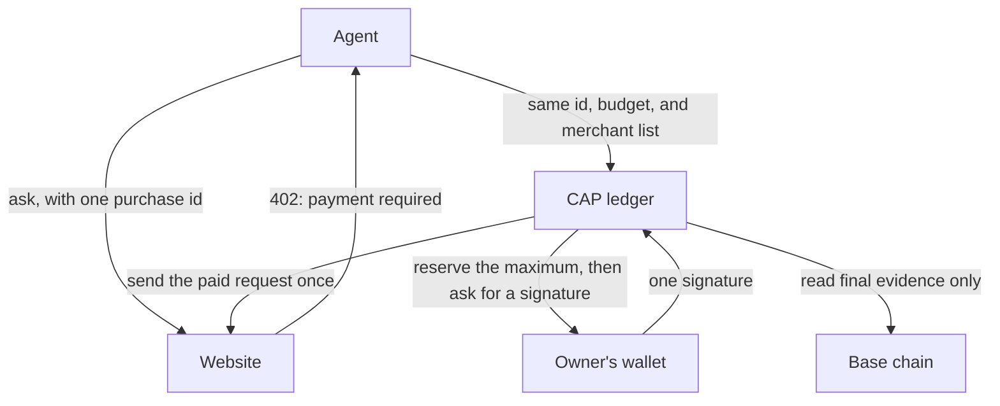
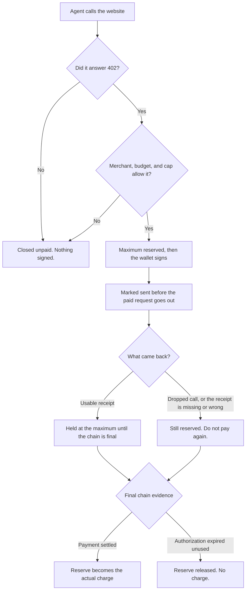

# CAP

CAP brings a payment record to an agent that spends its owner's USDC.

An agent can call a website that answers HTTP 402, the "payment required" response from [x402](https://github.com/coinbase/x402). CAP is the layer around that payment. It gives the owner one shared budget, a cap on each purchase, and a list of merchants the agent may pay. Every purchase keeps one id. If the connection drops, that same purchase stays open until there is final evidence, so a retry cannot spend the money a second time.

The owner still signs. CAP never sees the wallet keys, and it never takes custody of the USDC.

## What it brings

- **One purchase, one id.** The same id is the same purchase. A new id is a new charge.
- **A shared budget.** Every agent drawing on that budget spends from the same limit.
- **A cap on each payment.** A single purchase cannot exceed its own maximum.
- **A merchant list.** CAP will only prepare a payment for a website on that list.
- **A record when the outcome is unclear.** The purchase stays open until the chain shows what happened.

USDC here is the pinned dollar-pegged token on Base. Tests use Base Sepolia. Amounts are decimal strings. 1 USDC is `1000000`, because the token uses six decimal places.

## How a payment moves

The agent asks the website for something. If the work is free, CAP closes the purchase and the wallet is never used. If the website answers 402, CAP checks the merchant, the budget, and the cap, then asks the owner to sign once.



## Life of one purchase



The reserve is a row in CAP's books. The USDC stays in the owner's wallet until the payment settles on the chain. A later 402 response does not return money that already moved. A paid website does not, by itself, mean the work was useful.

When the outcome is unclear, the application uses the same purchase id and asks CAP to reconcile it.

## What an application connects

CAP keeps the record. The application around it brings the authority and the infrastructure.

| The application brings | What CAP uses it for |
| --- | --- |
| An authenticated caller | Ids name the owner, budget, agent, and purchase. They do not grant access. |
| A signer with `address` and `signTypedData` | CAP asks this wallet to sign. The key stays outside CAP. |
| A read-only chain connection the application trusts | Recovery follows that connection's view of the chain. |
| The application's PostgreSQL pool | The ledger lives there. CAP does not open or close the pool. |
| The merchant list and the budget | These are the limits on this spend. |

## Use it

Packages are not published yet. [Build from source](CONTRIBUTING.md#development) or [install matching local packages](CONTRIBUTING.md#local-packages).

The example below creates the ledger, a budget of 1 USDC, and a client whose largest single purchase is 0.01 USDC. It then buys one answer from a website.

```js
import { createAgentPayments } from '@cap/payments';
import { installPaymentSchema, PostgresPaymentStore } from '@cap/payments/postgres';

async function main({ pool, signer, rpc, context, service }) {
  const network = 'eip155:84532';
  await installPaymentSchema(pool);
  const store = new PostgresPaymentStore(pool);
  await store.createBudget({
    ownerId: context.ownerId,
    budgetId: context.budgetId,
    network,
    payer: signer.address,
    limitAtomic: '1000000',
  });

  const payments = createAgentPayments({
    network,
    store,
    policy: {
      maxPerPaymentAtomic: '10000',
      allowedSchemes: ['exact'],
      merchants: [{ origin: service.origin, payTo: service.payTo }],
    },
    resolveSigner: async () => signer,
    rpc,
  });
  const response = await payments.fetch(context, service.url);
  return { response, payments, store };
}
```

`context` is `{ ownerId, budgetId, agentId, operationId }`. `service` is `{ origin, payTo, url }`.

Read the response body, or cancel it. That includes `error.response` when a call fails. Those bodies are not safe to log. A failed purchase is reconciled with the same client and the same purchase id.

The field-by-field contract is in the [SDK README](packages/payments/README.md#backend-contract). The meaning of the balances is in [Balance and recovery](packages/payments/README.md#what-balances-mean).

## Try a purchase with no money

After [building from source](CONTRIBUTING.md#development):

```sh
npm exec --workspace @cap/testing -- cap test --agent-module "$PWD/examples/agent.mjs"
```

This runs a simulation. It needs no wallet, no chain credentials, and no PostgreSQL. Both cases should pass: `exact-payment` ends held `0` / spent `1000`, and `operator-budget-recovery` ends held `0` / spent `2400`. Add `--json` for the full report. Options are in the [tester guide](packages/testing/README.md).

## Before real money

CAP reserves the maximum before the wallet signs. An uncertain payment stays reserved until final evidence arrives. The budget covers this ledger's USDC. Gas, and any spending outside CAP, sit outside that budget.

Keep a stable purchase id, and pass amounts as decimal strings. A paid request should not be retried automatically. The in-memory store is for tests. Production uses PostgreSQL.

Read [SECURITY.md](SECURITY.md) before connecting a wallet.

## Status

CAP 0.1.0 is an experimental preview for Apple Silicon, Node 24.22.2, and Rust 1.93.0. The locked-dependency scan still fails on [RUSTSEC-2026-0387](SECURITY.md#current-release-gate), so this preview is not a release for production funds.

Setup, local checks, and publication steps are in [CONTRIBUTING.md](CONTRIBUTING.md).

## License

CAP is [MIT licensed](LICENSE). Third-party material keeps its own licenses and attribution in [NOTICE](NOTICE), including the UBB-derived behavior and the pinned x402-rs 2.0.2 types and ABIs.
